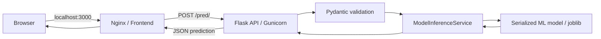

# ESTATE / AI — Apartment Price Prediction Microservice

[](https://www.python.org/)
[](https://flask.palletsprojects.com/)
[](https://docs.docker.com/compose/)
[](https://github.com/el-tka/model_inference_microservice/actions/workflows/lint.yml)

**ESTATE / AI** is a containerized machine-learning inference application that estimates apartment prices from property characteristics. It combines a Flask prediction API, a serialized boosting model, a responsive browser interface, and an Nginx reverse proxy.

The project demonstrates an end-to-end **model-serving workflow**: structured input validation, feature alignment, inference, API endpoints, health checks, automated tests, CI, and multi-container local deployment.

> **Scope:** This repository serves a pre-trained model; it does not contain a model-training pipeline or documented evaluation metrics. Predictions are illustrative model outputs, not certified real-estate appraisals. The target currency/unit is not specified in the repository.

## Features

- **REST API:** GET and POST predictions at `/pred/`.
- **Input validation:** Pydantic v2 schema with numeric and binary-feature constraints.
- **Feature-safe inference:** model inputs are reordered to match feature metadata saved with the model.
- **Model artifact:** a bundled `.joblib` file containing the estimator and metadata.
- **Web UI:** responsive property valuation form with prediction and error states.
- **Containerization:** separate Flask/Gunicorn and Nginx containers orchestrated with Docker Compose.
- **Observability:** `/health` and `/ready` endpoints, Loguru console/file logging, and a Docker health check.
- **Quality checks:** pytest tests, coverage collection, Flake8 linting, and GitHub Actions CI.

## Architecture



The frontend container publishes **port 3000** on the host. Nginx serves `frontend/index.html` and forwards `/pred/` requests to the backend container on port **5000** over the Compose network. The backend port is not published directly to the host in `compose.yaml`.

**Model loading:** the shared inference service loads the model during application startup. The current POST handler also creates a new `ModelInferenceService` and reloads the artifact for each request; this is a known optimization opportunity.

## Tech stack

| Layer | Technologies |
| --- | --- |
| API | Python 3.12, Flask, Gunicorn |
| Validation and settings | Pydantic v2, pydantic-settings |
| ML inference | joblib, pandas, NumPy; model dependencies include XGBoost, CatBoost, LightGBM and scikit-learn |
| Logging | Loguru |
| Frontend | HTML, CSS, vanilla JavaScript |
| Reverse proxy | Nginx |
| Containers | Docker, Docker Compose |
| Testing and CI | pytest, pytest-cov, Flake8, GitHub Actions |
| Dependency management | Poetry |

## Quick start — Docker Compose

### Requirements

- Docker Engine / Docker Desktop with Docker Compose support
- A working Docker daemon

```bash
git clone https://github.com/el-tka/model_inference_microservice.git
cd model_inference_microservice
docker compose up --build -d
```

Open **http://localhost:3000** in your browser, enter apartment characteristics, and select **Рассчитать стоимость** (Calculate price).

Useful commands:

```bash
docker compose ps                 # Container status
docker compose logs -f backend    # Backend logs
docker compose logs -f frontend   # Nginx logs
docker compose stop               # Stop containers without removing them
docker compose start              # Restart stopped containers
docker compose down               # Stop and remove Compose containers
```

The backend container is started by Gunicorn (`run:app`) and is configured with a health check against `http://localhost:5000/health` **inside the backend container**. The frontend waits for the backend to become healthy.

## API reference

### `POST /pred/` — predict from JSON

Use the browser-facing address when running Docker Compose:

```bash
curl -X POST http://localhost:3000/pred/ \
  -H "Content-Type: application/json" \
  -d '{
    "area": 75,
    "constraction_year": 2015,
    "bedrooms": 2,
    "garden": 0,
    "balcony_yes": 1,
    "parking_yes": 1,
    "furnished_yes": 1,
    "garage_yes": 0,
    "storage_yes": 1
  }'
```

Example response shape (the value depends on the model):

```json
{
  "prediction": [123456.78]
}
```

**Status codes implemented in the POST handler:** `200` for successful prediction, `400` for an empty/non-object JSON payload, and `422` for Pydantic validation errors. Unexpected model/runtime errors are not mapped to a custom API response.

### `GET /pred/` — predict from query parameters

```text
http://localhost:3000/pred/?area=75&constraction_year=2015&bedrooms=2&garden=0&balcony_yes=1&parking_yes=1&furnished_yes=1&garage_yes=0&storage_yes=1
```

Example response shape:

```json
{
  "Model prediction": [123456.78]
}
```

The GET handler returns **400** for invalid inputs. **GET and POST currently use different response keys**; client integrations should account for this until the API is standardized.

### Input schema

All nine fields are required by the `Apartment` schema.

| Field | Type | Constraint | Description |
| --- | --- | --- | --- |
| `area` | integer | > 0 | Apartment area |
| `constraction_year` | integer | 1800–2100 | Year of construction |
| `bedrooms` | integer | ≥ 0 | Number of bedrooms |
| `garden` | integer | 0 or 1 | Garden available |
| `balcony_yes` | integer | 0 or 1 | Balcony available |
| `parking_yes` | integer | 0 or 1 | Parking available |
| `furnished_yes` | integer | 0 or 1 | Furnished |
| `garage_yes` | integer | 0 or 1 | Garage available |
| `storage_yes` | integer | 0 or 1 | Storage available |

> **Compatibility note:** `constraction_year` is spelled this way in the current API and model feature schema. Preserve the spelling in requests unless the model and API are migrated together.

### Health and readiness

The following routes are registered in Flask:

| Route | Meaning | Example |
| --- | --- | --- |
| `GET /health` | Application liveness | `{"status":"ok"}` |
| `GET /ready` | Whether the shared model instance is loaded | `{"status":"ready","model":"..."}` or HTTP 503 with `{"status":"not_ready"}` |

These endpoints are accessible on the backend's port 5000 **inside the Docker network**. The included Nginx configuration proxies `/pred/` and `/api/`, but **does not proxy `/health` or `/ready`**, so they are not exposed through `http://localhost:3000` without additional Nginx configuration.

> The frontend tries `/api/v1/predict` first and falls back to `/pred/` on HTTP 404. Only `/pred/` is implemented in the Flask code included in this repository.

## Configuration

The root `.env.example` documents these settings:

```dotenv
MODEL_OUTPUT_PATH=model/models
MODEL_NAME=best_boosting_model_db_v1.joblib
LOG_LEVEL=INFO
```

`compose.yaml` sets these environment variables for the backend container. For local Python execution, you can export the variables in your shell or create `app/config/.env` using the same keys. The configuration classes also provide defaults for the model path/name and log level.

The bundled model is located at:

```text
app/model/models/best_boosting_model_db_v1.joblib
```

`ModelInferenceService` resolves relative model paths from the `app/` directory. The serialized artifact is expected to contain the keys `model`, `features`, and `model_name`. The service builds a one-row pandas DataFrame and orders columns according to the saved feature list before calling `predict()`.

**Security note:** only load `.joblib` model artifacts from trusted sources; joblib/pickle deserialization can execute code.

## Local development

### Requirements

- Python **3.12**
- Poetry

From the repository root:

```bash
poetry install
```

Start Flask:

```bash
cd app
poetry run python run.py
```

The development server listens on **127.0.0.1:5000**. In a separate terminal, serve the frontend:

```bash
cd frontend
python -m http.server 3000
```

**Important:** the current frontend uses relative `/pred/` requests, which are designed for Nginx proxying. Python's simple static server does **not** proxy API calls. For the complete UI/API workflow, use the Docker Compose setup or configure a development reverse proxy.

## Tests and code quality

Run from the repository root:

```bash
poetry run pytest tests/ -v
poetry run pytest --cov=app tests/
poetry run flake8 app/ tests/
```

Equivalent Makefile targets:

```bash
make test
make coverage
make lint
make docker-build
make docker-up
make docker-down
```

The included tests cover successful POST requests, invalid/missing inputs, empty requests, health/readiness routes, and feature ordering before inference. Tests use fixtures and test doubles for parts of the inference workflow; they are not a substitute for an end-to-end deployed-service test.

## Continuous integration

The GitHub Actions workflow at `.github/workflows/lint.yml` runs on **pushes and pull requests to `main`** using `ubuntu-24.04`.

The pipeline:

1. Checks out the repository.
2. Sets up Python 3.12.10 and Poetry using a local composite action.
3. Restores or installs a cached Poetry virtual environment.
4. Runs Flake8 against `app/` and `tests/`.
5. Runs pytest and collects test coverage.

**CI is implemented; automated production deployment is not included in the uploaded repository.** Docker Compose provides local container orchestration, not a public hosting URL.

## Repository structure

```text
.
├── .github/
│   ├── actions/build-application/action.yml
│   └── workflows/lint.yml
├── app/
│   ├── api/
│   │   ├── health.py
│   │   └── prediction.py
│   ├── config/
│   │   ├── logger.py
│   │   └── model.py
│   ├── model/models/
│   │   └── best_boosting_model_db_v1.joblib
│   ├── schema/
│   │   ├── apartment.py
│   │   └── prediction.py
│   ├── services/
│   │   ├── __init__.py
│   │   └── model_inference.py
│   └── run.py
├── frontend/
│   ├── Dockerfile
│   ├── index.html
│   └── nginx.conf
├── tests/
│   ├── conftest.py
│   ├── test_api.py
│   └── test_model_inference.py
├── .dockerignore
├── .env.example
├── .gitignore
├── Dockerfile
├── Makefile
├── compose.yaml
├── poetry.lock
├── pyproject.toml
├── setup.cfg
└── README.md
```

## Logging and operations

Loguru writes formatted logs to standard error and rotates application log files under `logs/app.log` (10 MB rotation, 7-day retention, ZIP compression). In containers, inspect runtime logs with:

```bash
docker compose logs -f backend
```

The Docker Compose backend uses one Gunicorn worker with a 60-second timeout. Review memory consumption, model load time, and worker settings before scaling or deploying to a resource-constrained host.

## Current limitations and next steps

- **API consistency:** unify GET/POST response formats and error handling; the `PredictionResponse` schema exists but is not used by the routes.
- **Inference efficiency:** reuse the already-loaded model in POST instead of loading the artifact on every request.
- **Public deployment:** add hosting and a CD stage if a public demo URL is required.
- **Evaluation transparency:** document the training dataset, target units, model selection, and evaluation metrics when those artifacts become available.
- **Operational hardening:** add integration tests for Nginx-to-Flask requests, request tracing, and resource/performance monitoring.

## License

No license file is included in this repository. Usage and redistribution permissions are therefore not explicitly granted. Add an appropriate `LICENSE` file if you intend to make the project reusable by others.

---

**ESTATE / AI** · Flask inference API · Dockerized web interface · Automated quality checks
